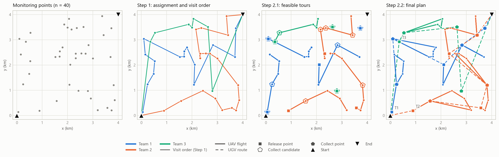
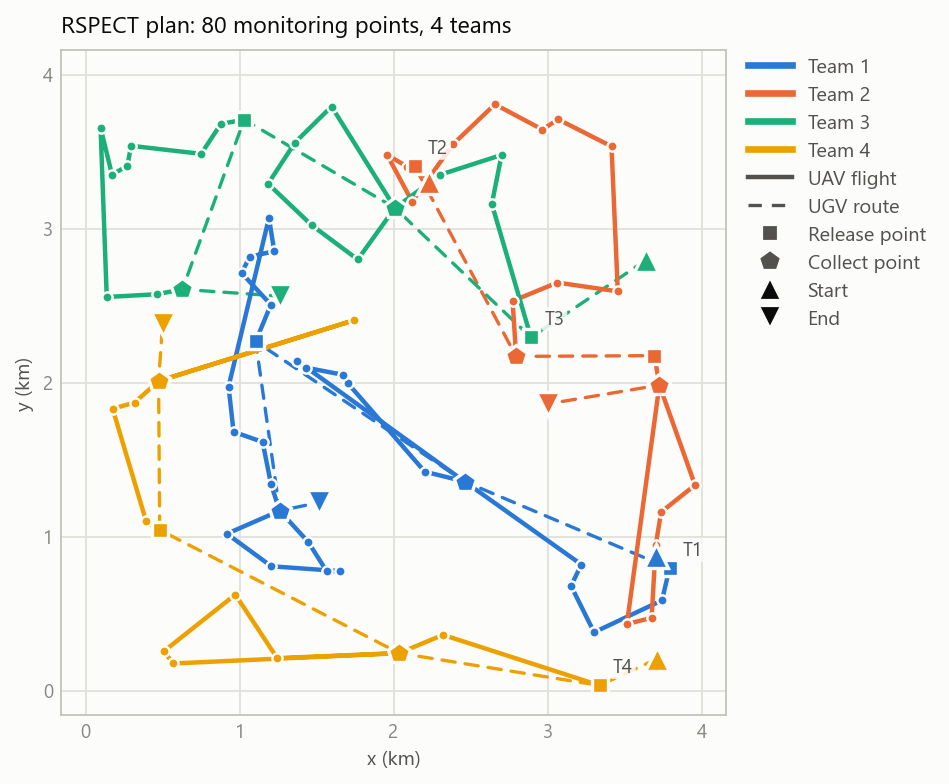
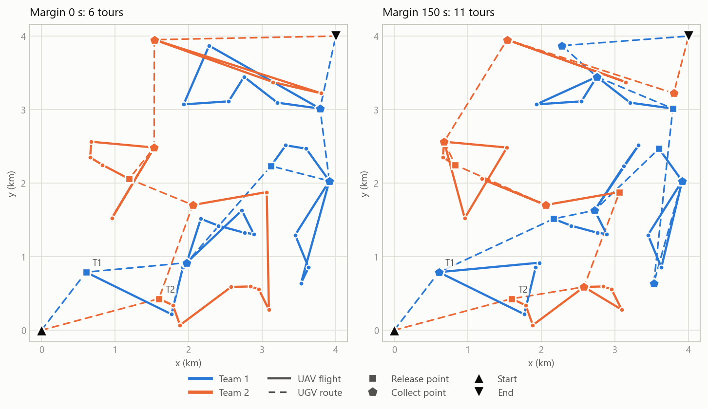

# RSPECT

**Robust and Scalable Planner for Energy-Aware Coordination of UAV-UGV Teams in Aerial Monitoring**

[](https://doi.org/10.1007/s10846-026-02426-5)
[](https://youtu.be/jQkGfwVTdBc)

Code for our paper in the *Journal of Intelligent & Robotic Systems* (2026): RSPECT,
plus our simulated annealing, genetic algorithm and branch and cut baselines. Developed at
the [Multi-Agent Robotics and Autonomy Lab](https://github.com/Multi-Agent-Robotics-and-Autonomy-Lab),
Northeastern University.

## Abstract

We consider the robust planning of energy-constrained unmanned aerial vehicles (UAVs) and
unmanned ground vehicles (UGVs), which act as mobile charging stations, to perform
long-horizon aerial monitoring missions. More specifically, given a set of points to be
visited by the UAVs and desired final positions of the UAV-UGV teams, the objective is to
find a robust plan (the vehicle trajectories) that can be realized without a major
revision in the face of uncertainty (e.g., unknown obstacles/terrain, wind) to complete
this mission in minimum time. We provide a formal description of this problem as a
mixed-integer program (MIP), which is NP-hard. Since exact solution methods are
computationally intractable for such problems, we propose RSPECT, a scalable and
efficient heuristic. We provide theoretical results on the complexity of our algorithm
and the feasibility and robustness of resulting plans. We also demonstrate the
performance of our method via simulations and experiments.

<picture>
  <source media="(prefers-color-scheme: dark)" srcset="docs/steps_dark.png">
  
</picture>

## How RSPECT works

1. **Assign and order the points.** Points are taken in random order and each one goes
   to the team whose route (a nearest-neighbour TSP from its start to its end) keeps the
   longest team route shortest.
2. **Cut every route into flights.** Walking along a team's route, a flight starts right
   below the next point and keeps adding points while the UAV can still land somewhere
   its UGV reaches in time, with the safety margins reserved. The possible landing
   (collect) points of every flight are recorded.
3. **Choose the collect points.** A generalized TSP, solved with
   [GLNS](https://github.com/stephenlsmith/GLNS.jl), picks one collect point per flight
   so that the team finishes as early as possible.

RSPECT runs in `O(mn + n^3)` time for `m` teams and `n` points. With margins `delta_a`
and `delta_g`, the plan stays within every battery limit as long as no flight takes more
than `delta_a` longer than planned and no drive more than `delta_g` longer, which also
leaves room to move release and collect points around unexpected obstacles.

## Installation

From the repository root:

```bash
pip install -e .
```

The last step of RSPECT calls GLNS, a Julia package:

1. Install [Julia](https://julialang.org/downloads/).
2. Install GLNS: `julia -e 'using Pkg; Pkg.add("GLNS")'`

`julia` must be on your `PATH`, or set the `RSPECT_JULIA` environment variable to the
executable. The first call compiles GLNS (about 10 s); later calls in the same Python
session take milliseconds.

The branch and cut baseline also needs Gurobi: `pip install gurobipy` and a license
(free for academic use).

## Quick start

```python
from rspect import MissionParams, make_instance, rspect
from rspect.plotting import plot_plan, save_figure

instance = make_instance(n=60, m=3, seed=4)      # 60 points, 3 teams, 4 km x 4 km area
params = MissionParams(delta_a=60, delta_g=60)    # keep 60 s of slack on every flight and drive
solution = rspect.solve(instance, params)

print(solution.summary())
save_figure(plot_plan(instance, solution).figure, "plan.png")
```

All four planners share this interface: `rspect.solve`, `sa.solve`, `ga.solve` and
`bnc.solve` take an instance (and optional `MissionParams`) and return a `Solution` with
the plan, the mission time of every team and the computation time.

## Examples

| Script | What it does |
|---|---|
| [`examples/rspect_quickstart.py`](examples/rspect_quickstart.py) | Plans a mission and plots it (`--n`, `--m`, `--random-endpoints`) |
| [`examples/rspect_steps.py`](examples/rspect_steps.py) | Shows each step of RSPECT (figure above) |
| [`examples/rspect_robustness.py`](examples/rspect_robustness.py) | Plans the same mission with and without safety margins |
| [`examples/sa_example.py`](examples/sa_example.py) | Simulated annealing on a small instance |
| [`examples/ga_example.py`](examples/ga_example.py) | Genetic algorithm on a small instance |
| [`examples/bnc_example.py`](examples/bnc_example.py) | Branch and cut on a tiny instance (needs Gurobi) |

```bash
python examples/rspect_quickstart.py --n 80 --m 4 --seed 2 --random-endpoints
```

Figures are saved to `outputs/`.

<picture>
  <source media="(prefers-color-scheme: dark)" srcset="docs/plan_dark.png">
  
</picture>

Safety margins trade mission time for robustness: with 150 s reserved, flights get
shorter and more numerous.

<picture>
  <source media="(prefers-color-scheme: dark)" srcset="docs/robustness_dark.png">
  
</picture>

## Planners

| File | Planner | Practical size |
|---|---|---|
| [`rspect/rspect.py`](rspect/rspect.py) | **RSPECT** (Algorithm 1 of the paper) | large missions |
| [`rspect/sa.py`](rspect/sa.py) | Simulated annealing over plan matrices | about 10 points |
| [`rspect/ga.py`](rspect/ga.py) | Genetic algorithm over plan matrices | about 10 points |
| [`rspect/bnc.py`](rspect/bnc.py) | Branch and cut on a MIQCP (Gurobi) | about 5 points |

The baselines search the full plan space, so their run time grows quickly; keep their
instances small.

## Mission model

[`rspect/problem.py`](rspect/problem.py) defines the planning problem shared by all
planners. Defaults follow the paper and can be changed through `MissionParams`:

| Parameter | Default |
|---|---|
| UAV speed, horizontal / vertical | 10 m/s / 2 m/s |
| Flight altitude | 100 m |
| UAV flight time per charge | 600 s |
| UGV speed | 2.5 m/s |
| Recharge ratio `gamma` (recharge time = `gamma` x tour time) | 1 |
| Safety margins `delta_a`, `delta_g` | 0 s |

A team's mission time is computed as in Eq. (2) of the paper:

- The UGV drives to the first release point.
- Each flight lasts as long as the slower of the UAV's flight and the UGV's drive to the
  collect point.
- Between flights, the UGV carries the UAV to the next release point while it recharges.
- The mission ends when the UGV reaches its end position.

Missions take place in an obstacle-free 4 km x 4 km area, distances are Euclidean, and
UAVs take off and land vertically.

## Repository layout

```
rspect/
  problem.py     planning problem: parameters, instances, mission time, constraints
  rspect.py      RSPECT
  glns.py        bridge to the GLNS solver (Julia) used by RSPECT
  sa.py          simulated annealing baseline
  ga.py          genetic algorithm baseline (reuses the SA encoding and moves)
  bnc.py         branch and cut baseline (Gurobi)
  plotting.py    plan figures
examples/        one script per planner, plus RSPECT walkthroughs
tests/           pytest suite (tests needing Julia or Gurobi are skipped without them)
docs/            README figures (regenerate with python docs/make_figures.py)
```

## Tests

```bash
pip install -e ".[test]"
pytest
```

## Citation

```bibtex
@article{er2026rspect,
  title   = {{RSPECT}: Robust and Scalable Planner for Energy-Aware Coordination of {UAV}-{UGV} Teams in Aerial Monitoring},
  author  = {Er, Cahit Ikbal and Kashiri, Amin and Yaz{\i}c{\i}o{\u{g}}lu, Yasin},
  journal = {Journal of Intelligent \& Robotic Systems},
  volume  = {112},
  pages   = {91},
  year    = {2026},
  doi     = {10.1007/s10846-026-02426-5}
}
```

A video of the hardware experiments with Crazyflie UAVs and Turtlebot UGVs is on
[YouTube](https://youtu.be/jQkGfwVTdBc).
